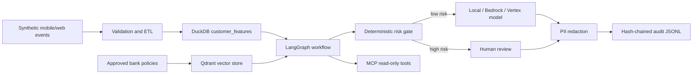

# Digital Banking AI Intelligence Platform

## What was combined

| Source repository | Reused capability | Integration in this branch |
|---|---|---|
| EvalForge | grounded retrieval, deterministic checks, human review, audit-friendly evidence | `banking_ai/retrieval.py`, risk gate, evidence-carrying responses |
| global-commerce-data-platform | Bronze/Silver/Gold mindset, data contracts, DuckDB, API, tests | synthetic digital-event ETL and `customer_features` warehouse |
| LinkedIn-Reply-Assistant-MVP | workflow orchestration, safe message generation, audit log | LangGraph nodes and guarded response generation |
| Understand-Anything | knowledge graph and system-explanation concept | architecture graph and Mermaid endpoints; no third-party source code copied |
| Windows-Network-Recovery-Toolkit | Observation → Proof → Policy → Audit governance model | deterministic risk gate, PII redaction, hash-chained audit records |

## Architecture

## Guardrails

- Synthetic data only; no real customer data.
- Read-only tools; the assistant cannot execute transactions.
- Risk is assessed before model generation.
- High-risk security and transfer requests are routed to human review.
- Prompts, responses, and audit payloads are PII-redacted.
- Every workflow stage is stored in a verifiable hash chain.
- Cloud model adapters are optional and disabled by default.

## Source ownership note

`Understand-Anything` is an upstream open-source project. This integration uses only the general knowledge-graph concept and does not copy its implementation. Preserve licenses and attribution whenever importing third-party code in the future.

## MVP versus future work

Implemented: Python, DuckDB feature ETL, LangGraph workflow, Qdrant local vector store with fallback, MCP tools, FastAPI, audit chain, deterministic policy gate, Bedrock and Vertex adapters.

Future: OAuth/RBAC, production Qdrant authentication, BigQuery deployment, event streaming, model tuning, prompt-injection test suite, real human-review UI, model monitoring, and banking-system integration.
